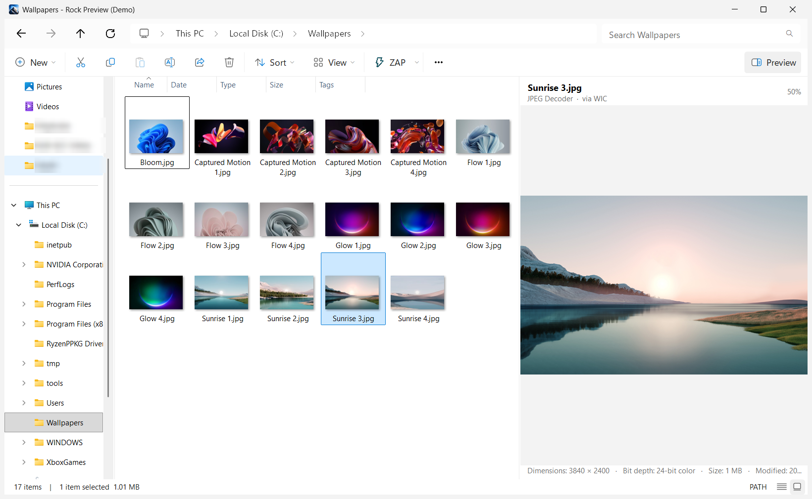
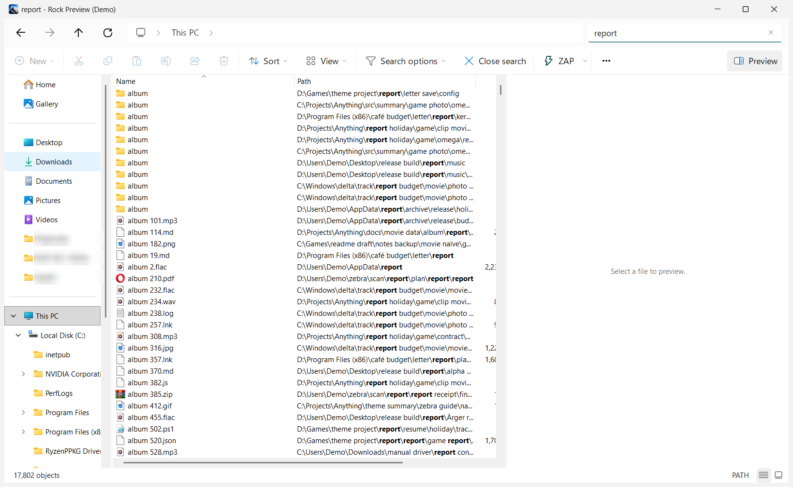

<div align="center">


# Ultimate File Explorer

*Formerly Rock Preview*

**Find any file instantly. Browse with the real Windows 11 Explorer. Preview anything without opening it.**

One fast Windows app that combines an instant whole-disk search engine, File Explorer itself, and a preview pane
that understands hundreds of formats — from PSD, CorelDRAW and TIFF to PDF, Office documents, RAW photos and video.

Press **`Alt+X`** in any app to open it.

[](https://github.com/RockySharaf/rock-preview/releases/latest)
[](https://github.com/RockySharaf/rock-preview/actions/workflows/build.yml)
[](LICENSE)


**[⬇ Download Ultimate File Explorer](https://github.com/RockySharaf/rock-preview/releases/latest)** · [Features](#features) · [Search syntax](#search-syntax) · [Build from source](#build-from-source)



</div>

---

## Why Ultimate File Explorer?

File Explorer's search is slow, and opening a file just to see what's in it wastes time — especially for design files
like PSD, AI or CorelDRAW that take ages to launch. Ultimate File Explorer fixes both:

- **⚡ Instant search** — reads the NTFS Master File Table directly, so millions of files are indexed in seconds and
  every keystroke filters the whole disk immediately. The index stays live as files change.
- **🗂️ The real Explorer, built in** — not a look-alike: Ultimate File Explorer hosts Windows' own Explorer file view and
  navigation pane, so context menus, drag and drop, rename, thumbnails and shell extensions all just work.
- **👁️ Preview anything** — select a file and see it, without opening another app.
- **🖼️ Thumbnails of everything** — one click shows your search results, or *every* file in a folder and its
  subfolders at once, as thumbnails.

## Features

### Instant search
- Indexes NTFS volumes from the Master File Table and keeps up with changes through the USN change journal.
  Without administrator rights it falls back to fast folder scanning and file-system notifications.
- Every drive, not just the internal ones: exFAT, FAT32 and ReFS drives (Dev Drives too), USB sticks and memory cards
  while they're plugged in (they can still be safely removed), CDs and DVDs, disks mounted in a folder, and mapped
  network drives. Network drives are checked for changes on a schedule and stay searchable while the network is away.
  Drives that appear while the app runs are added within seconds; SUBST drives are skipped so nothing shows up twice.
- Also search any folder, including `\\server\share`, even inside a drive or folder you leave out.
  **Settings › Indexing** shows every drive with how many items it holds.
- Results update as you type, across every drive. Select folders first to search only inside them: the search box
  says where it looks ("Search images").
- Powerful query language: wildcards, regular expressions, AND / OR / NOT, and functions for size, dates, type,
  extension, attributes, parent folder and more ([syntax below](#search-syntax)).
- As much about each file as Everything shows: besides size, dates modified and created and attributes, the
  **Date Accessed**, **Date Recently Changed**, **Run Count** and **Date Run** columns (right-click a column header to
  show them), and folder sizes if you want them ([more below](#information-about-each-file)).
- **Search inside files**, if you want it: the words in PDFs, Word, Excel and PowerPoint, text files, saved emails
  and design files, and optionally pictures' details (size, DPI, RGB or CMYK, date taken, camera, keywords). A
  **Matching text** column shows the line each file matched, and the preview opens at the match with the words
  highlighted ([more below](#search-inside-files)).
- Sort by any column, highlight matches, bookmarks for saved searches, export results to CSV / TXT.
- `rockpreview-cli` for scripting searches from the command line.

### Information about each file
Everything's extra columns, searches and sorts are all here, with the same options in **Settings › Indexing**:

| Column | Search | What it is | Option (default) |
|---|---|---|---|
| Date Accessed | `da:yesterday` | When the file was last opened, from the drive's file table (or the folder listing) | Kept in the index: off, as in Everything. Off, it's read from the disk when shown or searched, which is slower |
| Date Recently Changed | `rc:today` | When the app saw the file created, changed, moved or renamed (permissions and attributes count too, as in Everything) | On. *Reach back with the change journal* fills it from NTFS change journals at startup, so it goes back days, not just to when the app started |
| Run Count, Date Run | `runcount:>2`, `dr:thisweek` | How often you opened the file from the results (Enter or double-click), and when last. Right-click › *Set Run Count...* changes it | On. Kept in `Run History.csv` in Everything's format; *Import* brings in Everything's own |
| Size, for folders | `folder: size:>1gb` | The size of everything in the folder, kept up to date as files change | Off, as in Everything |

What they cost, measured on a PC with 3.17 million files and folders: date accessed adds 27 MB of memory (8 bytes
each); folder sizes add nothing (a folder's size takes the place it already has) and are worked out in 78 ms; recent
changes take about 60 bytes for each file that changed (1.8 MB for 31,758 changes). Run history is a small file.
Turning on date accessed reads the drives again once, in the background; everything stays searchable meanwhile.

### Search inside files
Off unless you choose it, in Setup or **Settings › Indexing › Search inside files**, which offer three choices and show
what each costs on your PC, worked out from the number and size of your files (for example "About 30 MB for 4,000
documents; the first pass takes about 2 minutes in the background"):

| Choice | What is read |
|---|---|
| Search files by name | Nothing: names only, as before |
| Also search inside documents | The words in PDF, Word, Excel and PowerPoint (2007 and later), OpenDocument, text, RTF, HTML, saved emails (EML, MSG: subject, sender, recipients, text and attachment names) and design files (PSD's text layers; the text of AI and IDML files; InDesign and EPS files' title, description, keywords, fonts and plates, not their layout's text). Only the text: never the pictures in a PDF, a document's layout or a design's pixels; at most the first 1 MB of text per file |
| Also search inside documents and pictures' details | Also pictures' size in pixels, resolution (DPI), colour mode (RGB or CMYK), date taken, camera, place, title and keywords, read from their headers only |

- It reads your own folders (Desktop, Documents, Downloads, Pictures and OneDrive) unless you add drives, folders or
  network shares, or leave some out. Keys, certificates, password stores, password exports, recovery codes and app data
  are never read (they are known by their names).
- The first pass runs in the background at low priority, newest and most-opened files first, and slows down while you
  use the PC; it waits while on battery (unless you allow it) and while the app runs as administrator. After that only
  files that change are read again, as the name index sees them change. Settings shows how far it is and which files
  couldn't be read, and why (password-protected, too big, …); pause it there for an hour or until you resume.
- On a print shop's 10 TB NAS (about 850,000 print PDFs) the text index comes to about 0.7 GB; the first pass is most
  of a day of reading (about 15–22 hours at full speed, at most 8 MB/s), reading about 200–700 GB over the network
  depending on how many pages the PDFs have.
- Text in scans and screenshots isn't read yet: reading it (OCR) is planned, and **Settings › Indexing** lists it as
  coming later.
- With **Search › Match inside files** on (the default, set in **Settings › Search**), a plain search word of three or
  more letters also finds files with that word inside (in Chinese, Japanese or Korean, two characters; a longer run
  of those matches names only, so use `content:` for it); files matched by name come first, then those matched only
  inside files; **Match Case** and **Match Diacritics** apply inside files too, while with **Match Path** or **Regex** on
  search words match names only (the status bar says NAMES ONLY). `content:` searches only inside files. The
  **Matching text** column (hide it from the column header's
  menu) shows the matching line, with the page, slide, sheet or line it is on; the tooltip shows all of it.
- The preview opens at the match: text files scroll to the line with the words highlighted, Word and PowerPoint files
  show their text highlighted (**Show original** brings back their own preview), workbooks open the sheet, PDFs open
  the page, and pictures say which field matched.

### Windows 11 File Explorer, inside
- Hosts the genuine Explorer file view (`ExplorerBrowser`) and navigation pane (`NamespaceTreeControl`) —
  Home, Gallery, your pinned folders, This PC, Network.
- A pixel-faithful Windows 11 frame: tabs, breadcrumb address bar, command bar with Explorer's own icons
  (New, Cut, Copy, Paste, Rename, Share, Delete, Sort, View), search box, status bar and view switcher.
  Sizes, colours and behaviour were measured from Explorer itself, not guessed.
- **This PC** opens as Explorer shows it: drive tiles with a storage bar (red when nearly full) and "X GB free of
  Y GB", locked BitLocker drives with their lock. Other folders open in Details; **View** switches either.
- The real shell **New** menu, the Windows **Share** sheet, Properties, Select all / none / invert.
- Light and dark themes, the file view included.

### Tabs
Like Windows 11 File Explorer, one window holds several folders and searches as tabs along the top:

- **`Ctrl+T`** or **+** opens a tab at Home; **`Ctrl+W`**, the tab's **×** or a middle click closes it (closing the
  last tab closes the window). **`Ctrl+Tab`** / **`Ctrl+Shift+Tab`** move between tabs, and tabs can be dragged into
  another order.
- Each tab keeps its own folder, Back/Forward history, search, results, sort and Thumbnails view. Switching is instant:
  the other tabs stay open in the background, nothing loads again.
- Right-click a tab to duplicate it, open it in a new window, or close the others. Right-click folders in the search
  results to open them in new tabs.
- Folders opened from Windows (when Ultimate File Explorer replaces File Explorer) and **Win+E** open as a new tab in
  the window you used last. **Settings › General › Open folders in tabs** turns that off for a new window each time.

### Preview pane — hundreds of formats
| Kind | Examples |
|---|---|
| Images & RAW | JPG, PNG, GIF, WebP, AVIF, HEIC, JXL, TIFF, BMP, TGA, DDS, ICO, SVG, CR2/CR3, NEF, ARW, DNG, RAF… |
| Design | **PSD**, **CorelDRAW (CDR)**, **Illustrator (AI)**, **InDesign**, Affinity, Krita, XCF, Figma, XD, EPS |
| Documents | **PDF** (multi-page), Word, Excel, PowerPoint, Visio, OpenDocument, RTF, XPS, EPUB, email (EML/MSG) |
| CAD & 3D | DWG, DXF, STL, OBJ, 3MF, FBX, Blender, SketchUp |
| Media | MP4, MKV, MOV, AVI, WebM, MP3, FLAC, WAV, OGG… |
| Code & text | 100+ languages and config formats, CSV/TSV tables, JSON, XML, Markdown, logs |
| Other | Archives (ZIP, 7z, RAR…), fonts, executables, certificates, and a hex view for anything else |

Office and other installed shell preview handlers are hosted in place; embedded thumbnails are used where a format has one.

### Thumbnails
Press **Thumbnails** (or `Ctrl+Shift+X`) to see files as pictures:

- **While searching**, your results switch to thumbnails, wherever on the disk they are.
- **In a folder**, every file in it *and all its subfolders* appears at once, straight from the index — perfect for
  "show me all the images in this project". They come in the order the folder showed them (newest first in
  Downloads, for example); **Sort** changes it. Press Thumbnails again to go back to the folder.

The arrow next to it shows the same files as a list instead (`Ctrl+Shift+Z`), or only the folder's own files.

**Everyday files** (next to Thumbnails while every file shows) keeps it to what people look at: pictures (camera raw
too), videos, music, documents and PDFs, e-books, design and 3D files, fonts and ZIP/RAR/7z archives. Code, settings,
logs, program and system files are left out. It's on until you turn it off; turn it off to see every file.

A folder the index doesn't have (left out in **Settings › Folders**, on a drive that's turned off, or not read yet)
is read straight from the disk instead, and kept up to date while it shows. A bar says why its files don't show up in
searches, with **Show them in searches** to add them. While a folder is still being read, the view says so instead of
looking empty. The first few times a folder stays open for a few seconds, the Thumbnails button glows briefly, until you
use Thumbnails (10 times at most).

<div align="center">

</div>

### Use it instead of Windows File Explorer (optional)
Turn on **Settings › General › Use instead of Windows File Explorer** (or the same box in Setup) and Ultimate File Explorer
takes over:

- opening folders and drives (from the desktop, the Start menu and other apps), **Win+E**, and **This PC**;
- **File Explorer's taskbar button**: it becomes Ultimate File Explorer's, in the same place, and every Ultimate File Explorer window groups
  under it.

Inside Ultimate File Explorer, folders open in the same window, and folders opened from Windows open as a new tab in
the window you used last (or in a new window: **Settings › General › Open folders in tabs**). Untick the box (or
uninstall) and File Explorer comes back exactly as it was: Ultimate File Explorer keeps a copy of everything it changes
and puts it back. Only your own Windows account is affected. **Settings ⌄ › Open in File Explorer** (the arrow next to
the gear) always opens the real File Explorer.

One thing Windows doesn't allow: folders **double-clicked on the desktop** still open in File Explorer. The desktop is
part of File Explorer and opens them itself, without asking the settings other apps use (tested on Windows 11), and
Ultimate File Explorer doesn't patch File Explorer to change that.

## Install

1. Download **`RockPreview-Setup.exe`** from the [latest release](https://github.com/RockySharaf/rock-preview/releases/latest)
   and run it. Choose *Just me* (no administrator needed) or *Everyone on this PC*. Instant indexing, a desktop
   shortcut, *Start with Windows* (so `Alt+X` opens Ultimate File Explorer at any time), *Use it instead of Windows File
   Explorer* and new-version notices are all on by default; untick any you don't want. When setup finishes, a small
   window in the corner gives a short tour, ticking off each step as you try it: `Alt+X` to hide Ultimate File Explorer
   and bring it back, Thumbnails, subfolders, Sort, and choosing which folders to search. **Help › Get Started** shows
   it again.
   Setup also asks whether to **search inside files**: names only (the default), also inside documents, or also
   pictures' details, each with its size and first-pass time worked out from your folders. Change it, or add drives
   and network folders, any time in **Settings › Indexing**; the app offers it once if you install without choosing.
   To update, run the new Setup: it closes the running copy (wherever it runs from), replaces it and keeps your settings
   and earlier choices.
2. Prefer no install? Download **`RockPreview.exe`** — the portable version runs from any folder or USB stick.

Both are self-contained: nothing else (not even .NET) needs to be installed. Uninstall from **Settings › Apps**.

> **Windows SmartScreen** may say "Windows protected your PC" because the download isn't code-signed yet.
> Click **More info › Run anyway**.

> **Instant indexing, approved once.** Reading a drive's Master File Table needs administrator rights, so Setup offers
> *Instant indexing for all drives*: it installs the small **Ultimate File Explorer Service** and Windows asks for permission one
> time. After that Ultimate File Explorer runs as a normal app (no more prompts) and the service reads the drives for it, like
> Everything's service. You can also turn it on later from the yellow bar or **Settings › Indexing**. Without it,
> Ultimate File Explorer still works: it indexes by scanning folders, which is slower the first time.

### Updates

Ultimate File Explorer tells you when a new version is out. Once a day it asks GitHub for its latest release; when there is a
newer one you get a Windows notification and a bar in the window, both linking to the release page with what's new
and the installer. Install it over the old version: settings, index and bookmarks stay. **Help › Check for Updates**
checks right away. Turn the daily check off in Setup or **Settings › General**.

## Keyboard shortcuts

| Keys | Action |
|---|---|
| `Alt+X` | Open or hide Ultimate File Explorer from any app (change it in **Settings › Keyboard**) |
| `Ctrl+T` | New tab |
| `Ctrl+W` | Close the tab (the last one closes the window) |
| `Ctrl+Tab` / `Ctrl+Shift+Tab` | Next / previous tab |
| `Ctrl+F` / `Ctrl+E` | Search |
| `Ctrl+L`, `Alt+D`, `F4` | Type a path in the address bar |
| `Alt+←` / `Alt+→` / `Alt+↑` | Back / Forward / Up |
| `Alt+P` | Show or hide the preview pane |
| `Ctrl+Shift+X` | Thumbnails: the search results, or every file in the folder and its subfolders |
| `Ctrl+Shift+Z` | Every file in the folder and its subfolders, as a list |
| `Ctrl+Shift+N` | New folder |
| `Alt+Enter` | Properties |
| `F5` | Refresh |
| `Ctrl+I` `Ctrl+B` `Ctrl+U` `Ctrl+R` | Match case / whole word / path / regex |
| `Ctrl+1` … `Ctrl+8`, `Ctrl+9` | Sort by Name, Path, Size, Extension, Type, Date Modified, Date Created, Attributes; Date Recently Changed |
| `Ctrl+D` | Bookmark the current search |
| `Ctrl+P` | Settings (also the gear on the command bar; its arrow has the rest of Explorer's **⋯** menu) |
| `Ctrl+N` | New window |
| `Esc` | Clear the search / back to the folder |
| `F1` | Search syntax help |

## Search syntax

| Query | Finds |
|---|---|
| `invoice 2024` | names containing both words |
| `report \| summary` | either word |
| `!tmp` | names *not* containing "tmp" |
| `*.psd` | wildcards (`*` any text, `?` one character) |
| `"annual report"` | an exact phrase |
| `ext:psd;ai;cdr` | design files |
| `size:>100mb` | files over 100 MB |
| `dm:today` · `dm:lastweek` | modified today / last week |
| `da:yesterday` · `dc:2024` | accessed yesterday / created in 2024 |
| `rc:today` | created, changed, moved or renamed today |
| `runcount:>2` · `dr:thisweek` | opened more than twice / opened this week (from the results) |
| `parent:"D:\Photos"` | items directly inside a folder |
| `path:projects logo` | match against the full path |
| `regex:^IMG_\d{4}\.jpg$` | a regular expression |
| `audio:` `video:` `pic:` `doc:` `zip:` `exe:` | built-in type filters |
| `content:invoice` | files with a word starting with "invoice" inside (with [search inside files](#search-inside-files) on) |
| `content:"annual report"` · `ww:content:report` | words next to each other / exactly that word |
| `content:INV-2024` · `content:inv*24` | a code, whatever its separators / a wildcard within one word |
| `title:` `subject:` `author:` `keywords:` (`tags:`) `comment:` (`description:`) | a word in that field (documents' properties, pictures; an email's subject is `subject:`, its sender `author:`) |
| `from:` · `to:` | an email's sender / recipients (To and Cc) |
| `dpi:<300` · `cmyk:` · `rgb:` · `colormode:gray` | pictures' resolution and colour mode (`cmyk: logo` = CMYK pictures named or tagged "logo") |
| `width:>=3000` · `dimensions:2480x3508` · `orientation:portrait` | pictures' size in pixels |
| `datetaken:2023` · `camera:canon` · `gps:` | date taken, camera, with a place |
| `pagecount:>20` · `contentstatus:failed` | pages, slides or sheets / files that couldn't be read |

Press `F1` in the app for the complete reference.

## Command line

```text
RockPreview.exe [search text]        open with a search
RockPreview.exe -path "D:\Projects"  open a folder
RockPreview.exe -explorer [-path X]  a new tab in the window used last, like File Explorer (at X, or Home)
RockPreview.exe -admin               restart elevated (instant NTFS index)
RockPreview.exe -startup             start in the background
RockPreview.exe -exit                close the running instance
rockpreview-cli ext:pdf size:>10mb   search the saved index from a script (-h for options; -da, -run-count add columns)
rockpreview-cli content:invoice      search inside files too, from the text index (-match-content: plain words too)
```

## Build from source

Requirements: Windows 10 or 11, the [.NET 10 SDK](https://dotnet.microsoft.com/download).

```powershell
git clone https://github.com/RockySharaf/rock-preview.git
cd rock-preview
dotnet build -c Release
dotnet test
# Self-contained single-file builds: dist\RockPreview-Setup.exe and dist\RockPreview.exe
powershell -ExecutionPolicy Bypass -File build\Publish.ps1
```

### Project layout
| Project | What it is |
|---|---|
| `src/Anything.Core` | The index (compact in-memory file table), NTFS MFT reader, USN journal monitor, folder scanner, query parser and search engine |
| `src/Anything.Preview` | The preview pane and renderers for every supported format, plus the thumbnail provider |
| `src/Anything` | The Windows app: Explorer hosting, Windows 11 chrome, results list and thumbnails, setup |
| `src/Anything.Cli` | `rockpreview-cli` |
| `tests/Anything.Tests` | Unit tests for indexing and search |

## Privacy

Ultimate File Explorer runs entirely on your PC. It has no telemetry and no account. Its index and settings stay in
`%LOCALAPPDATA%\Rock Preview` and `%APPDATA%\Rock Preview` (with `Run History.csv`, which files you opened from the
results and when; **Settings › Indexing › Run history** turns it off or clears it).

Search inside files is off unless you choose it. When it's on: a copy of each document's text (up to 1 MB) is kept on
this PC, in your own profile; never pictures or layout, and nothing leaves this PC. It is kept in
`%LOCALAPPDATA%\Rock Preview\Content`, beside the name index, never in a roaming profile. Files are read by the app itself, as you (so only what
you may open), never by the Ultimate File Explorer Service; while it runs as administrator it reads nothing.
Keys, certificates, password stores, password-manager and browser exports, recovery and backup codes, `.env` files and
app data folders are never read (they are known by their names), files Windows marks "don't index contents" are left
out (their words leave the index as soon as the mark is set), and files encrypted by Windows only if you allow it. Choosing **Search files by name**
again deletes the text index at once; *Also delete my settings and search index* when uninstalling deletes it too.
`rockpreview-cli` can read the text index (as it reads the name index), and a CSV exported with the **Matching text**
column contains document text.

Its only network connection is the check for a new version: at most once a day (and when you choose **Help › Check
for Updates**) it asks GitHub's API for the latest release of `RockySharaf/rock-preview`. The request carries
Ultimate File Explorer's version number and nothing about you, your PC or your files; GitHub sees it like any web request. It
downloads nothing by itself. Turn it off in Setup or **Settings › General**.

The optional Ultimate File Explorer Service runs from `C:\Program Files\Rock Preview Service` (only administrators can change
it). It answers only the Windows accounts that installed it, only on this PC, never over the network. It returns file
names, folders, sizes and dates from local NTFS drives (internal and USB), and never raw disk data or file contents. Uninstalling Rock
Preview removes it.

## Roadmap

- Updating in one click, from the new-version notice
- Code-signed releases and a Microsoft Store listing
- ARM64 builds

Ideas and bug reports are welcome in [Issues](https://github.com/RockySharaf/rock-preview/issues).

## License

Ultimate File Explorer is free software, released under the [GNU General Public License v3.0](LICENSE).
Copyright © 2026 Rocky Sharaf.

Ultimate File Explorer is an independent project, not made by or affiliated with Microsoft or voidtools; File Explorer
is the file manager built into Windows. Its search syntax is
compatible with the query language popularised by voidtools' *Everything*. Windows' own icons are loaded from your
Windows installation at run time and are not distributed with Ultimate File Explorer.
